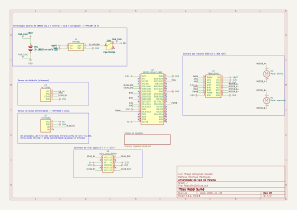
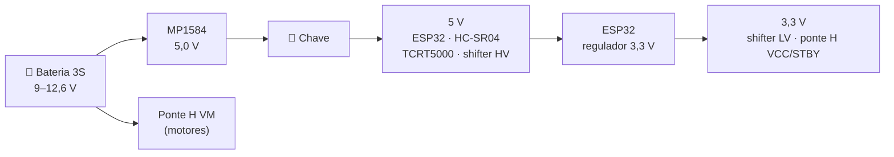
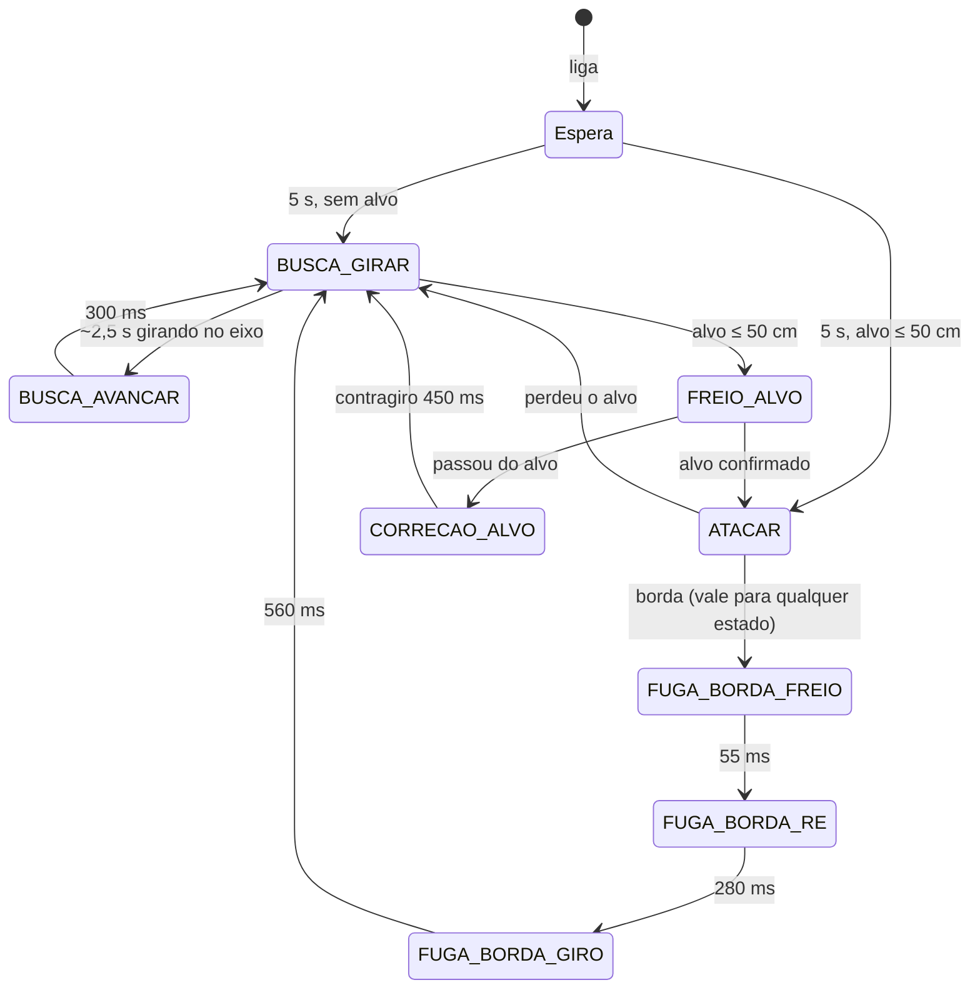

<div align="center">

# 🤖 Robô Sumô 10x10

**Robô autônomo com ESP32 que encontra e derruba uma garrafa sem sair da arena**


Sistemas Embarcados · Universidade do Vale do Paraíba

**Luiz Thiago Gonçalves Cassab** · **Matheus Henrique Rodrigues**

</div>

---

## 📑 Sumário

- [Sobre o projeto](#-sobre-o-projeto)
- [Vídeo](#-vídeo)
- [Diagrama elétrico](#-diagrama-elétrico)
- [Componentes utilizados](#-componentes-utilizados)
- [Alimentação](#-alimentação)
- [Pinagem do ESP32](#-pinagem-do-esp32)
- [Montagem](#-montagem)
- [Firmware](#-firmware)
- [Decisões de projeto](#-decisões-de-projeto)
- [Validação e testes](#-validação-e-testes)
- [Estrutura do repositório](#-estrutura-do-repositório)

---

## 🎯 Sobre o projeto

Robô de 10 cm × 10 cm desenvolvido para uma prova de competição: encontrar e **derrubar uma garrafa** dentro de uma arena **totalmente preta** (~65–70 cm) **sem sair dela** — sair da arena significa derrota.

O projeto passou por todas as etapas de um sistema embarcado: desenho do circuito no KiCad, montagem em placa de fenolite, simulação do comportamento no Wokwi, desenvolvimento do firmware em ESP-IDF e teste no robô real.

> 🏆 **Resultado: 1º lugar na competição de robôs da disciplina.**

| Sensor | Papel no robô |
|:---:|---|
| 📡 **HC-SR04** (ultrassom, frente) | Procura o alvo e decide quando atacar |
| 👁️ **TCRT5000** (infravermelho, voltado para o chão) | Detecta qualquer cor que não seja preta → borda da arena |

---

## 🎥 Vídeo

| Vídeo | Duração | Link |
|---|---|---|
| 🏆 **Demonstração de competitividade — parte 1** | 7 s | ▶️ [Assistir / baixar](https://github.com/ltcassab/Robo-Sumo-10x10/releases/download/v1.0/Video-Competicao-1.mp4) |
| 🏆 **Demonstração de competitividade — parte 2** | 25 s | ▶️ [Assistir / baixar](https://github.com/ltcassab/Robo-Sumo-10x10/releases/download/v1.0/Video-Competicao-2.mp4) |
| 🔧 **Explicação do hardware** | 4 min 23 s | ▶️ [Assistir / baixar](https://github.com/ltcassab/Robo-Sumo-10x10/releases/download/v1.0/Video-Hardware.mp4) |
| 💻 **Explicação do código-fonte** | 9 min 10 s | ▶️ [Assistir / baixar](https://github.com/ltcassab/Robo-Sumo-10x10/releases/download/v1.0/Video-Codigo-Fonte.mp4) |

> Os vídeos estão na [Release v1.0](https://github.com/ltcassab/Robo-Sumo-10x10/releases/tag/v1.0), na qualidade original.

---

## 🔌 Diagrama elétrico

O circuito foi desenhado no **KiCad** (revisão **R2**). Os pinos do ESP32 aparecem com os dois nomes: o padrão do esquemático (`Dxx`) e o impresso na placa utilizada (`Gxx`).

<p align="center">
  <a href="Diagrama-Eletrico.pdf"></a>
</p>

<details>
<summary><b>📋 Página 2 — Tabela de ligações (clique para abrir)</b></summary>
<br>
<p align="center">
  
</p>
</details>

📄 **[Diagrama em PDF](Diagrama-Eletrico.pdf)** · 🛠️ [Projeto KiCad](hardware/kicad)

---

## 🧩 Componentes utilizados

| | Componente | Função |
|:---:|---|---|
| 🧠 | ESP32 DevKit **38 pinos** (WROOM-32) | Controlador |
| ⚙️ | Ponte H **TB6612FNG** | Aciona os dois motores |
| 🔩 | 2× motor **N20 12 V, 300 rpm** | Tração |
| 📡 | **HC-SR04** | Distância até o alvo |
| 👁️ | **TCRT5000** (módulo de 4 pinos) | Borda da arena |
| 🔋 | 3× **18650** em série (3S, 9 a 12,6 V) | Bateria |
| ⬇️ | **MP1584** (step-down) | Gera 5 V a partir da bateria |
| 🔁 | **Level shifter** BSS138 (4 canais) | Converte ECHO e D0 de 5 V para 3,3 V |
| 🔘 | Push-button **com trava** (6 pinos) | Liga/desliga da linha de 5 V |

---

## 🔋 Alimentação



O sistema tem três níveis de tensão:

- **Bateria (9–12,6 V):** alimenta direto a ponte H (VM), que entrega essa tensão aos motores N20 de 12 V.
- **5 V:** gerados pelo MP1584, regulado para 5,0 V. Alimentam o ESP32, os dois sensores e o lado de 5 V do level shifter.
- **3,3 V:** vêm do regulador do próprio ESP32 e alimentam a lógica da ponte H (VCC e STBY) e o lado de 3,3 V do level shifter.

A **chave liga/desliga** foi colocada em série na linha de 5 V. Desligada, o ESP32 apaga; sem os 3,3 V, a ponte H é desabilitada e os motores param.

O **GND** foi distribuído em estrela: um barramento para o ESP32, os sensores e o shifter, e um fio mais grosso e separado para o GND da ponte H, que leva a corrente dos motores direto ao negativo da bateria.

---

## 📍 Pinagem do ESP32

| ESP32 | Ligado em | Motivo da escolha |
|---|---|---|
| `D22/G22` | HC-SR04 **TRIG** | Saída livre; 3,3 V já é suficiente para disparar o sensor |
| `D35/G35` | shifter LV1 ← HV1 ← HC-SR04 **ECHO** | Pino só de entrada, ideal para leitura de sensor |
| `D34/G34` | shifter LV4 ← HV4 ← TCRT5000 **D0** | Pino só de entrada; LOW = cor diferente de preto |
| `D13/G13` | TB6612 **PWMA** | Motor **direito** (A01/A02) |
| `D14/G14` | TB6612 **AIN1** | |
| `D12/G12` | TB6612 **AIN2** | Pino de *strapping*; a entrada da ponte H o mantém em LOW no boot |
| `D16/G16` | TB6612 **PWMB** | Motor **esquerdo** (B01/B02); livre no módulo WROOM-32 |
| `D26/G26` | TB6612 **BIN1** | |
| `D33/G33` | TB6612 **BIN2** | |
| `3V3` | shifter LV · TB6612 VCC e STBY | |
| `5V/V5` | saída da chave (5 V do MP1584) | |

---

## 🛠️ Montagem

O circuito foi montado em **placa de fenolite**, com os sensores ligados por adaptadores. Os fios foram padronizados por cor:

<table>
<tr><td valign="top">

**Alimentação e ponte H**

| Ligação | Cor |
|---|---|
| Bateria + / − | 🔴 vermelho / ⚫ preto |
| Linha de 5 V | 🔴 vermelho |
| Linha de 3,3 V | ⚪ branco |
| GND | ⚫ preto |
| PWMA | 🟡 amarelo |
| AIN2 | 🟢 verde |
| AIN1 | ⚪ branco |
| BIN1 | 🟣 roxo |
| BIN2 | 🔵 azul |
| PWMB | 🩶 cinza |

</td><td valign="top">

**Sensores (placa → adaptador)**

| Sensor | Pino | Placa | Adaptador |
|---|---|---|---|
| HC-SR04 | VCC | 🔴 vermelho | 🟤 marrom |
| | TRIG | ⚫ preto | 🟢 verde |
| | ECHO | 🟡 amarelo | 🟡 amarelo |
| | GND | ⚫ preto | 🟠 laranja |
| TCRT5000 | VCC | 🔴 vermelho | ⚪ branco |
| | GND | ⚫ preto | 🟣 roxo escuro |
| | D0 | ⚫ preto | 🔵 azul escuro |

</td></tr>
</table>

A sensibilidade do sensor de borda é ajustada no **trimpot** do módulo TCRT5000, de forma que ele indique "preto" na arena e mude de estado em qualquer outra cor.

---

## 💻 Firmware

O código final está em [`firmware/robo-sumo-idf`](firmware/robo-sumo-idf). Foi escrito em **C puro com ESP-IDF** e compilado e gravado com **PlatformIO**. A pinagem está separada em [`src/pins.h`](firmware/robo-sumo-idf/src/pins.h).

| Ambiente de desenvolvimento | |
|---|---|
| Framework | [ESP-IDF](https://github.com/espressif/esp-idf) 6.1.0 (sem bibliotecas do Arduino) |
| Build e gravação | [PlatformIO](https://platformio.org/) · plataforma `espressif32` · placa `esp32dev` · partição própria com 3 MB para a aplicação |
| Componentes do ESP-IDF usados | `driver/gpio` (sensores, direção dos motores e interrupção do ECHO) · `driver/ledc` (PWM 5 kHz, 8 bits) · `esp_timer` (tempo em µs) · FreeRTOS (loop de 10 ms) · `esp_log` (monitor serial) |
| Bibliotecas externas | Nenhuma |

O comportamento é uma **máquina de estados**:



| Situação | O que o robô faz |
|---|---|
| ⏱️ **Início** | Espera 5 s após ligar; nos últimos 400 ms já lê o ultrassom parado e, se houver alvo à frente, ataca direto |
| 🔍 **Procurando** | Gira no próprio eixo (~2,5 s, alternando o lado) e dá um passo curto para frente |
| 🎯 **Alvo a até 50 cm** | Se estava girando, freia (*short brake*) para não passar do alvo, confirma a leitura e **ataca reto** com rampa de partida |
| 💥 **Encostado no alvo** | Abaixo de 16 cm continua empurrando por até 450 ms, mesmo sem eco |
| ⛔ **Borda** (3 leituras seguidas fora do preto) | **Freia**, dá **ré** e **gira** de volta para o centro; se ainda estiver na borda, repete a ré |

**Parâmetros finais:**

| Parâmetro | Valor |
|---|---|
| Potência global (`FATOR_POTENCIA`) | 50% |
| Velocidade de ataque | PWM 127 (rampa a partir de 100) |
| Velocidade de giro / busca | PWM 85 / 80 |
| Alcance de detecção do alvo | 50 cm |
| Filtro da borda | 3 leituras seguidas (30 ms) |
| Ré na borda | 280 ms (PWM 90 → 110) |

O HC-SR04 é lido **por interrupção** no pino ECHO, sem travar o loop principal, com recuperação automática caso o ECHO fique preso em nível alto.

---

## 🧠 Decisões de projeto

- **Level shifter nos sinais de 5 V:** o ECHO do HC-SR04 e o D0 do TCRT5000 saem em 5 V, acima do limite do ESP32 (3,3 V), e por isso passam pelo conversor. O TRIG vai direto, porque 3,3 V já disparam o sensor.
- **Saída analógica A0 do TCRT5000 não utilizada:** ela chega a 5 V; o projeto usa só a saída digital D0, com o limite ajustado no trimpot.
- **Pinos 34 e 35 para os sensores:** são pinos só de entrada do ESP32, adequados para leitura.
- **Ponte H TB6612FNG com freio ativo (*short brake*):** colocar IN1 e IN2 em nível alto trava os motores mais rápido do que só cortar o PWM. Isso é usado tanto para parar na borda quanto para não passar do alvo ao detectá-lo durante o giro.
- **Chave só na linha de 5 V:** com o ESP32 desligado, a ponte H perde o 3,3 V do VCC/STBY e desabilita os motores, mesmo com a bateria ainda ligada ao VM.
- **Potência centralizada em um único fator:** todas as velocidades são definidas sobre a escala completa dos motores e multiplicadas por `FATOR_POTENCIA` (50% na versão final), o que permite ajustar a força do robô em um só lugar.

---

## 🧪 Validação e testes

| Etapa | O que foi feito |
|---|---|
| ✅ **Esquemático** | Verificação de regras elétricas (ERC) do KiCad sem erros e conferência das ligações pino a pino contra a placa soldada |
| ✅ **Simulação** | Comportamento simulado no **Wokwi** com testes automáticos: busca, ataque ao alvo e reação à borda ([`simulacao/`](simulacao)) |
| ✅ **Diagnóstico** | Programa próprio para analisar o sinal do HC-SR04 (motores desligados), usado durante a montagem ([`ferramentas/diagnostico-hc-sr04`](ferramentas/diagnostico-hc-sr04)) |
| ✅ **Robô real** | Firmware final gravado no ESP32, testado na arena e campeão da competição (1º lugar) |

Na simulação, o Wokwi não possui ponte H, conversor, level shifter nem TCRT5000; os sinais dos motores foram representados por LEDs e o sensor de borda por uma chave.

---

## 📂 Estrutura do repositório

```
Robo-Sumo-10x10/
├── Diagrama-Eletrico.pdf          # diagrama elétrico (2 páginas)
├── docs/                          # imagens usadas neste README
├── hardware/kicad/                # projeto KiCad R2
├── firmware/robo-sumo-idf/        # ⭐ código final (PlatformIO + ESP-IDF)
├── simulacao/
│   ├── wokwi-arduino/             # primeira versão do comportamento (Arduino) + teste
│   └── wokwi-idf-v1/              # versão anterior do firmware ESP-IDF + teste
└── ferramentas/diagnostico-hc-sr04/
```
