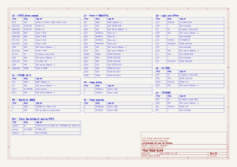
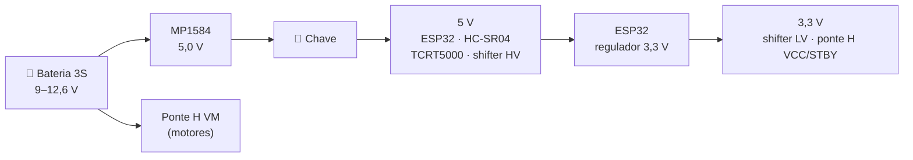
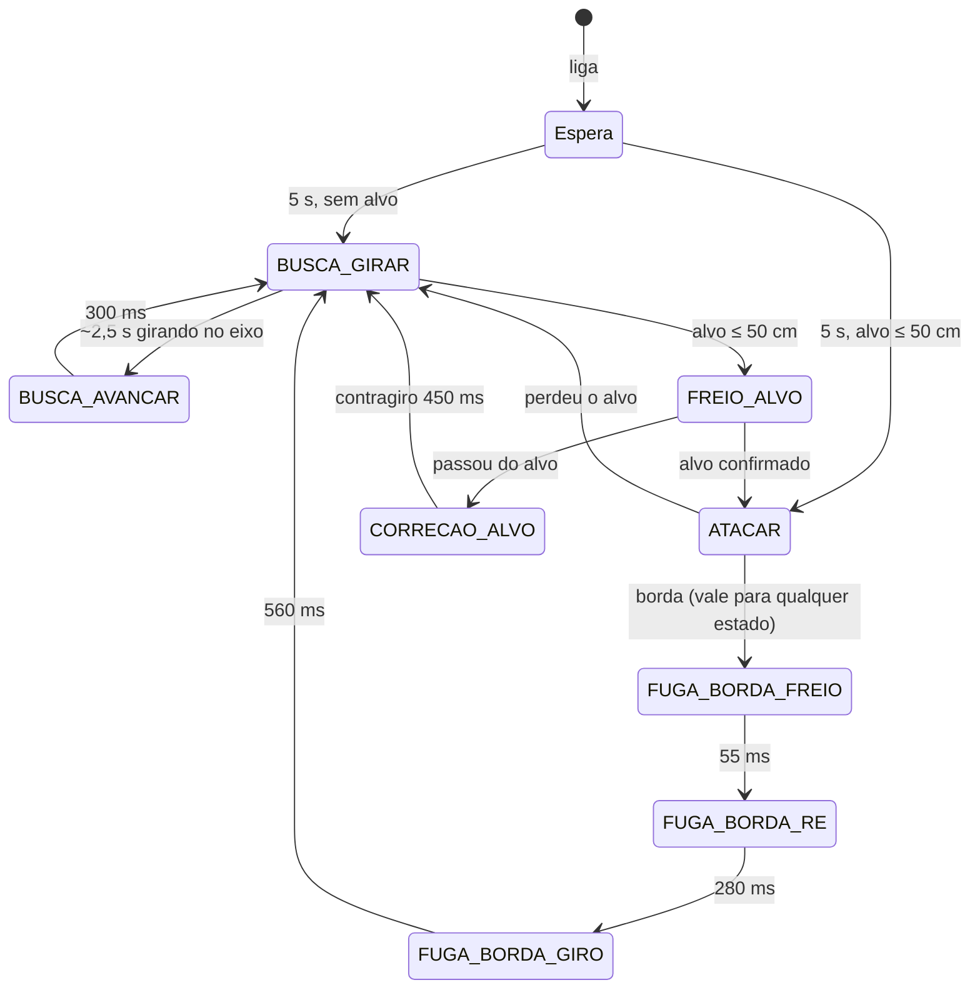

<div align="center">

# 🤖 Robô Sumô 10x10

**Robô autônomo com ESP32 que encontra e derruba uma garrafa sem sair da arena**


Sistemas Embarcados · Universidade do Vale do Paraíba

**Luiz Thiago Gonçalves Cassab** · **Matheus Henrique Rodrigues**

</div>

---

## 📑 Sumário

- [Sobre o projeto](#-sobre-o-projeto)
- [Diagrama elétrico](#-diagrama-elétrico)
- [Componentes](#-componentes)
- [Alimentação](#-alimentação)
- [Ligações do ESP32](#-ligações-do-esp32)
- [Cores dos fios](#-cores-dos-fios)
- [Firmware](#-firmware)
- [Calibração do infravermelho](#-calibração-do-infravermelho)
- [Simulação no Wokwi](#-simulação-no-wokwi)
- [Segurança](#%EF%B8%8F-segurança)
- [Estrutura do repositório](#-estrutura-do-repositório)

---

## 🎯 Sobre o projeto

Robô de 10 cm × 10 cm construído para uma prova de competição: encontrar e **derrubar uma garrafa** dentro de uma arena **totalmente preta** (~65–70 cm) **sem sair dela** — sair da arena é derrota.

| Sensor | Papel |
|:---:|---|
| 📡 **HC-SR04** (ultrassom, frente) | Procura o alvo e decide quando atacar |
| 👁️ **TCRT5000** (infravermelho, chão) | Detecta qualquer cor que não seja preta → borda da arena |

---

## 🔌 Diagrama elétrico

Feito no **KiCad** (revisão **R2**). Os pinos do ESP32 mostram os dois nomes: o do esquemático (`Dxx`) e o impresso na placa usada (`Gxx`).

<p align="center">
  <a href="Diagrama-Eletrico.pdf"></a>
</p>

<details>
<summary><b>📋 Página 2 — Tabela de ligações (clique para abrir)</b></summary>
<br>
<p align="center">
  
</p>
</details>

📄 **[Baixar o diagrama em PDF](Diagrama-Eletrico.pdf)** · 🛠️ [Projeto KiCad](hardware/kicad)

---

## 🧩 Componentes

| | Componente | Função |
|:---:|---|---|
| 🧠 | ESP32 DevKit **38 pinos** (WROOM-32) | Controlador |
| ⚙️ | Ponte H **TB6612FNG** | Aciona os dois motores |
| 🛞 | 2× motor **N20 12 V, 300 rpm** | Tração |
| 📡 | **HC-SR04** | Distância até o alvo |
| 👁️ | **TCRT5000** (módulo de 4 pinos) | Borda da arena |
| 🔋 | 3× **18650** em série (3S, 9 a 12,6 V) | Bateria |
| ⬇️ | **MP1584** (step-down) | Gera 5 V a partir da bateria |
| 🔁 | **Level shifter** BSS138 (4 canais) | ECHO e D0 de 5 V → 3,3 V |
| 🔘 | Push-button **com trava** (6 pinos) | Liga/desliga da linha de 5 V |

---

## 🔋 Alimentação



- **MP1584 ajustado para 5,0 V com multímetro, sem carga, antes de ligar o resto.**
- Furos do MP1584 na placa: **1, 2, 5, 6 = GND** · **3 = IN+** (bateria + e VM da ponte H) · **7 = OUT+ 5 V** · 4 e 8 sem uso.
- **GND em estrela:** o barramento sai do furo 5 para ESP32, sensores e shifter; o GND da ponte H vai num fio grosso separado até o furo 2, junto do negativo da bateria.
- **Chave:** em série só na linha de 5 V, sem GND. Desligada, o ESP32 apaga; sem 3,3 V, o VCC/STBY da ponte H caem e os motores param (o VM continua ligado na bateria).

---

## 📍 Ligações do ESP32

| ESP32 | Liga em | Observação |
|---|---|---|
| `D22/G22` | HC-SR04 **TRIG** | direto (3,3 V basta para o disparo) |
| `D35/G35` | shifter LV1 ← HV1 ← HC-SR04 **ECHO** | só entrada |
| `D34/G34` | shifter LV4 ← HV4 ← TCRT5000 **D0** | só entrada · LOW = não é preto |
| `D13/G13` | TB6612 **PWMA** | motor **direito** (A01/A02) |
| `D14/G14` | TB6612 **AIN1** | |
| `D12/G12` | TB6612 **AIN2** | pino de *strapping*: LOW no boot (a ponte H puxa para baixo) |
| `D16/G16` | TB6612 **PWMB** | motor **esquerdo** (B01/B02) |
| `D26/G26` | TB6612 **BIN1** | |
| `D33/G33` | TB6612 **BIN2** | |
| `3V3` | shifter LV · TB6612 VCC e STBY | |
| `5V/V5` | saída da chave (5 V do MP1584) | |

> O **A0** do TCRT5000 fica sem ligação (chega a 5 V). Os canais 2 e 3 do shifter não são usados.

---

## 🎨 Cores dos fios

<table>
<tr><td valign="top">

**Alimentação e ponte H**

| Ligação | Cor |
|---|---|
| Bateria + / − | 🔴 vermelho / ⚫ preto |
| Linha de 5 V | 🔴 vermelho |
| Linha de 3,3 V | ⚪ branco |
| GND | ⚫ preto |
| PWMA | 🟡 amarelo |
| AIN2 | 🟢 verde |
| AIN1 | ⚪ branco |
| BIN1 | 🟣 roxo |
| BIN2 | 🔵 azul |
| PWMB | 🩶 cinza |

</td><td valign="top">

**Sensores (placa → adaptador)**

| Sensor | Pino | Placa | Adaptador |
|---|---|---|---|
| HC-SR04 | VCC | 🔴 vermelho | 🟤 marrom |
| | TRIG | ⚫ preto | 🟢 verde |
| | ECHO | 🟡 amarelo | 🟡 amarelo |
| | GND | ⚫ preto | 🟠 laranja |
| TCRT5000 | VCC | 🔴 vermelho | ⚪ branco |
| | GND | ⚫ preto | 🟣 roxo escuro |
| | D0 | ⚫ preto | 🔵 azul escuro |

</td></tr>
</table>

> ⚠️ As cores mudam no conector do adaptador: na montagem, guie-se pelo **nome do pino**, não pela cor.

---

## 💻 Firmware

Código final em [`firmware/robo-sumo-idf`](firmware/robo-sumo-idf): **ESP-IDF em C puro**, compilado e gravado com **PlatformIO**. A pinagem fica em [`src/pins.h`](firmware/robo-sumo-idf/src/pins.h). Potência global de **50%** (`FATOR_POTENCIA`).



| Situação | O que o robô faz |
|---|---|
| 🔍 **Procurando** | Gira no próprio eixo (~2,5 s, alternando o lado) e dá um passo curto para frente |
| 🎯 **Alvo a até 50 cm** | Se estava girando, freia (*short brake*) para não passar do alvo, confirma a leitura e **ataca reto** com rampa de partida |
| 💥 **Encostado no alvo** | Abaixo de 16 cm continua empurrando por até 450 ms mesmo sem eco |
| ⛔ **Borda** (3 leituras seguidas fora do preto) | **Freia**, dá **ré** e **gira** de volta para o centro; se ainda estiver na borda, repete a ré |

O HC-SR04 é lido **por interrupção** no pino ECHO, sem travar o loop, com proteção contra ECHO preso em nível alto.

### ▶️ Como gravar

1. Abra [`firmware/robo-sumo-idf`](firmware/robo-sumo-idf) no VS Code com a extensão **PlatformIO**.
2. 🔋 **Tire as baterias (ou suspenda as rodas).**
3. Conecte o ESP32 no USB e use **Upload** → **Monitor** (115200).
4. A primeira linha mostra `POTENCIA 50%`; depois, a cada 200 ms, o estado, a distância e a borda.

> Ajustes rápidos ficam no topo do `main.c`: `FATOR_POTENCIA`, `DISTANCIA_ATAQUE_CM`, tempos das manobras e `INVERTER_MOTOR_DIR/ESQ` (se uma roda girar ao contrário).

---

## 👁️ Calibração do infravermelho

O TCRT5000 compara o reflexo com um limite ajustado no **trimpot**; o código só lê o D0 (preto = HIGH, outra cor = LOW).

1. Monte o sensor na altura final (uns **3 a 8 mm** do chão).
2. Sem baterias, com o ESP32 no USB, apoie o robô na arena preta.
3. Gire o trimpot até o **LED de sinal apagar no preto**; volte ao ponto em que ele acende e dê ~1/8 de volta de folga.
4. Passe sobre a borda/outra cor: o LED deve **acender**.

> 💡 Calibre no local da prova: luz forte interfere no infravermelho.

---

## 🧪 Simulação no Wokwi

O Wokwi não tem TB6612, MP1584, level shifter nem TCRT5000, então os sinais da ponte H aparecem em **LEDs** e o infravermelho é uma **chave deslizante** (direita = preto, esquerda = borda). Clique no HC-SR04 durante a simulação para mudar a distância.

| Pasta | Conteúdo |
|---|---|
| [`simulacao/wokwi-arduino`](simulacao/wokwi-arduino) | Primeira versão do comportamento em Arduino + teste automático |
| [`simulacao/wokwi-idf-v1`](simulacao/wokwi-idf-v1) | Versão anterior do código ESP-IDF + teste automático |

<details>
<summary><b>Como rodar</b></summary>

- **Navegador:** crie um projeto ESP32 em [wokwi.com](https://wokwi.com) e cole o código e o `diagram.json`.
- **Wokwi CLI:** compile para `build/` e rode `wokwi-cli --scenario teste.yaml .` com a variável `WOKWI_CLI_TOKEN` definida.
  - `wokwi-arduino`: copie `sketch.ino` para uma pasta chamada `sketch` e compile com `arduino-cli compile --fqbn esp32:esp32:esp32 --output-dir build`.
  - `wokwi-idf-v1`: rode `compilar_wokwi.ps1` (compila o código ESP-IDF pelo Arduino CLI só para simular).

</details>

### 🩺 Diagnóstico do ultrassônico

[`ferramentas/diagnostico-hc-sr04`](ferramentas/diagnostico-hc-sr04) mantém os motores desligados e imprime, a cada 200 ms, o nível do ECHO antes do disparo, o tempo até ele subir e a largura do pulso — separa problema de montagem (algo a menos de 3 cm do sensor, cilindros encostados no chassi, TRIG/ECHO trocados) de problema de código.

---

## ⚠️ Segurança

> [!CAUTION]
> - Ajuste o MP1584 para **5,0 V antes** de ligar qualquer carga.
> - Para gravar ou testar pelo USB, **tire as baterias**: a chave só corta o 5 V e, com USB, o 3,3 V mantém a ponte H ativa.
> - Nunca ligue o **VM** da ponte H no 5 V/3,3 V nem o **VCC** na bateria: 12 V no 3,3 V queima o ESP32.
> - O **A0** do TCRT5000 não pode ir direto ao ESP32 (5 V).

---

## 📂 Estrutura do repositório

```
Robo-Sumo-10x10/
├── Diagrama-Eletrico.pdf          # diagrama elétrico (2 páginas)
├── docs/                          # imagens do diagrama usadas no README
├── hardware/kicad/                # projeto KiCad R2
├── firmware/robo-sumo-idf/        # ⭐ código final (PlatformIO + ESP-IDF)
├── simulacao/
│   ├── wokwi-arduino/             # versão Arduino + teste Wokwi
│   └── wokwi-idf-v1/              # versão ESP-IDF anterior + teste Wokwi
└── ferramentas/diagnostico-hc-sr04/
```
